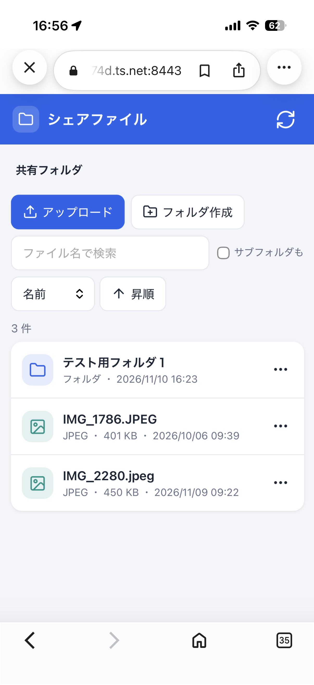
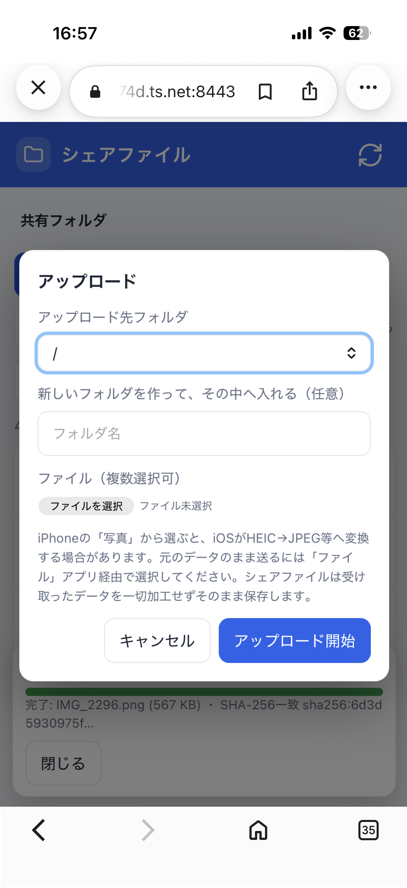

# シェアファイル 起動・停止手順

## 起動

デスクトップの「シェアファイル 起動」をダブルクリックします。

- 端末が開き、アクセスログが流れ続けます（この端末を閉じてもサーバーは動き続けます）。
- 初回のみ、仮想環境（`.venv`）の作成と依存パッケージのインストールが自動で行われます。
- 2回目以降は数秒で起動します。二重起動はしません。
- 起動後、Ubuntu のブラウザで http://127.0.0.1:8765/ が開きます。
- Tailscale に接続済みなら、Tailscale Serve（HTTPS 8443）も自動で設定され、iPhone 用の URL が端末に表示されます。

## 停止

デスクトップの「シェアファイル 停止」をダブルクリックします。

- サーバーのプロセスと、本システムが設定した Tailscale Serve のみを停止します。Tailscale 全体は止めません。
- ログを表示していた端末は、数秒で自動的に閉じます。

## デスクトップのアイコンについて

アイコンは `~/デスクトップ/ShareFile-start.desktop` と `ShareFile-stop.desktop` で、リポジトリの外にあります。なくなった場合は、次の内容で作り直し、右クリックから「起動を許可」を選びます。

    [Desktop Entry]
    Type=Application
    Name=シェアファイル 起動
    Exec=gnome-terminal -- bash -c "/home/akihiro/work/CopilotWork/ShareFile/start.sh"
    Terminal=false
    Icon=folder-publicshare

停止用は `Name` を「シェアファイル 停止」、`start.sh` を `stop.sh` に変えます。

ShareFile フォルダ内にも同名の `.desktop` がありますが、ファイルマネージャーによってはダブルクリックでテキストエディタが開きます。その場合はデスクトップのアイコンを使ってください。

## iPhone から使う

### 初回のみ

1. Ubuntu に Tailscale をインストールし、`sudo tailscale up --operator=$USER` でログインします。
2. Tailscale の管理画面で、MagicDNS・HTTPS 証明書・Serve を有効にします。
3. iPhone に Tailscale アプリを入れ、同じアカウントでログインします。

### 使うとき

1. Ubuntu で「シェアファイル 起動」をダブルクリックします。
2. iPhone で Tailscale をオンにし、ブラウザで次の URL を開きます。

       https://dell-tower-computer.taildc074d.ts.net:8443/

3. 一覧、アップロード、ダウンロードなどが使えます。

アップロードでは、保存先フォルダを選べます。新しいフォルダを作ってから入れることもできます。

写真アプリから選ぶと、iOS が HEIC を JPEG などに変換する場合があります。元のデータのまま送るには、「ファイル」アプリ経由で選んでください。

### URL を探さずに開く（ショートカット）

iPhone の「ショートカット」アプリで、次のアクションを順に並べて作ります。

1. 「Tailscale を接続」（表示は「Connect to your Tailscale network」）
2. 「URL」に上の URL を入力
3. 「URL を開く」

ライブラリのカードをタップするだけで、VPN をオンにして開けます。

### ダウンロードと保存

- 「ダウンロード」: ブラウザ標準のダウンロードです。
- 「写真に保存」（画像・動画）: 共有シートの「画像を保存」「ビデオを保存」で写真アプリに入ります。
- 「ファイルに保存」（PDF などの書類）: 共有シートから「ファイル」アプリに保存します。
- この保存ボタンは HTTPS で開いたときだけ表示され、300MB までです。それより大きいファイルは「ダウンロード」を使います。

## 設定

`config/sharefile.env` で変更します。同名の環境変数 `SHAREFILE_*` が優先されます。変更後は再起動してください。

- 共有フォルダ、ゴミ箱、ログの場所
- ポート、待ち受けホスト
- 最大アップロードサイズ（MB）
- Tailscale Serve の HTTPS ポート
- 追加で許可するホスト名

## ファイルの場所

- 共有フォルダ: `shared/`。ファイルマネージャーと Web で同じ実体を扱います。
- ゴミ箱: `trash/`。Web で削除したものの退避先で、共有フォルダの外にあります。
- ログ: `logs/server.log`

## セキュリティ

- アプリは 127.0.0.1 だけで待ち受け、Tailscale Serve 経由でのみ外から届きます。Funnel は使いません。
- 独自のログインはありません。同じ Tailnet の端末は操作できるため、必要なら Tailscale の ACL で、このPC への接続元を iPhone に限定してください。
